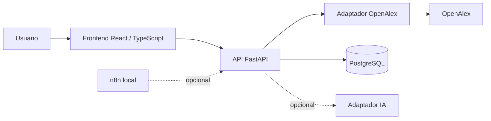
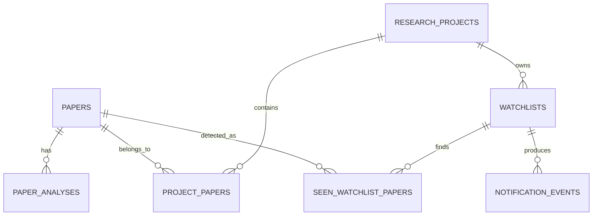

# Documento de análisis y diseño — ResearchFlow AI

## 1. Visión del sistema

ResearchFlow AI es una aplicación web local para apoyar revisiones bibliográficas. Convierte una consulta temática en una colección organizada de artículos: el usuario busca en OpenAlex, selecciona resultados, los guarda dentro de un proyecto, completa una matriz de literatura y la exporta a CSV.

El sistema no sustituye la lectura crítica ni atribuye al texto completo información obtenida solo de un abstract. La IA, si se incorpora, funciona como apoyo de extracción y nunca como fuente autónoma de hechos.

## 2. Actores

| Actor | Necesidad | Acciones principales |
|---|---|---|
| Investigador/a (usuario único) | Encontrar y organizar literatura | Crear proyecto, buscar, guardar, editar, exportar. |
| OpenAlex | Proveedor externo de datos | Devuelve metadatos y abstracts disponibles. |
| Proveedor de IA (opcional) | Extraer datos del abstract | Recibe solo contenido autorizado y devuelve JSON estructurado. |
| n8n (opcional) | Ejecutar revisiones programadas | Solicita al backend revisar watchlists. |

## 3. Requisitos funcionales

| ID | Requisito |
|---|---|
| RF-01 | El usuario puede crear y listar proyectos de investigación. |
| RF-02 | El usuario puede buscar publicaciones por texto y rango de años. |
| RF-03 | La búsqueda muestra título, autores, año, fuente, enlace y abstract cuando exista. |
| RF-04 | El usuario puede guardar y retirar artículos de un proyecto sin duplicados. |
| RF-05 | El usuario puede editar notas y campos de la matriz bibliográfica. |
| RF-06 | El usuario puede exportar la matriz a CSV. |
| RF-07 | El sistema puede analizar un abstract, si la integración de IA fue validada, y conserva evidencia por campo. |
| RF-08 | El sistema puede revisar novedades en watchlists y evitar alertas duplicadas, como extensión opcional. |

## 4. Requisitos no funcionales

- Funcionamiento local reproducible y sin costos obligatorios para el MVP.
- Respuestas claras ante parámetros inválidos, timeout, error upstream o límite de frecuencia.
- Validación de entradas y protección de secretos fuera del repositorio.
- Trazabilidad de análisis de IA: modelo, versión de prompt, fecha y alcance del input.
- Accesibilidad básica: etiquetas, navegación por teclado, contraste y errores visibles.
- Pruebas para el adaptador OpenAlex, API, deduplicación y CSV.

## 5. Casos de uso principales

### CU-01: Buscar publicaciones

1. El usuario escribe una consulta y, opcionalmente, un rango de años.
2. La interfaz solicita `GET /api/v1/papers/search`.
3. El backend valida los parámetros y consulta OpenAlex a través de su adaptador.
4. El adaptador normaliza la respuesta y reconstruye el abstract cuando sea posible.
5. La interfaz presenta resultados o un error controlado.

**Reglas:** un abstract no disponible se muestra como “No disponible”; no se interpreta como texto vacío. Un error 429, timeout o 5xx no bloquea la interfaz.

### CU-02: Construir matriz de literatura

1. El usuario crea un proyecto.
2. Selecciona un artículo de los resultados y lo guarda.
3. El backend persiste el artículo globalmente y asocia el artículo al proyecto.
4. Si la asociación ya existe, responde sin crear un duplicado.
5. El usuario modifica notas o campos revisados desde la matriz.
6. El usuario descarga el CSV resultante.

### CU-03: Extraer información desde un abstract (opcional)

1. El usuario solicita analizar un artículo con abstract disponible.
2. El backend aplica el contrato de análisis al contenido permitido.
3. El resultado registra por campo valor, estado, evidencia y alcance del input.
4. La interfaz muestra el resultado como propuesta revisable, no como conclusión verificada.

## 6. Arquitectura lógica

### Responsabilidades

| Componente | Responsabilidad |
|---|---|
| Frontend | Formularios, resultados, estados de UI y edición de matriz. |
| API | Validar solicitudes, aplicar reglas de negocio y entregar contratos estables. |
| Adaptador OpenAlex | Realizar HTTP, aplicar timeout/backoff, normalizar metadatos y manejar errores. |
| Base de datos | Mantener artículos, proyectos, asociaciones, análisis y eventos de forma consistente. |
| Adaptador IA | Usar prompts versionados, validar JSON y preservar evidencia. |
| n8n | Programar tareas y conectarse a rutas internas protegidas; no deduplicar por su cuenta. |

## 7. Diseño de datos

| Entidad | Propósito | Reglas esenciales |
|---|---|---|
| `research_projects` | Proyecto de revisión del usuario | Nombre y pregunta de investigación. |
| `papers` | Catálogo global de artículos | `openalex_id` único; DOI opcional. |
| `project_papers` | Relación proyecto–artículo | Única por `project_id` y `paper_id`; contiene notas y estado. |
| `paper_analyses` | Resultado de análisis asistido | Conserva modelo, prompt, alcance y estado de revisión. |
| `watchlists` | Consulta recurrente opcional | Pertenece a un proyecto. |
| `seen_watchlist_papers` | Registro de artículos detectados | Evita avisos repetidos. |
| `notification_events` | Historial de envío | Único por watchlist, artículo y canal. |

Relaciones principales:

## 8. Diseño de interfaces y API

| Recurso | Operación | Uso |
|---|---|---|
| `/papers/search` | GET | Buscar en OpenAlex con consulta, años y paginación. |
| `/projects` | POST, GET | Crear y listar proyectos. |
| `/projects/{id}/papers` | POST, GET | Guardar artículo y consultar matriz. |
| `/projects/{id}/papers/{paper_id}` | PATCH | Editar campos del usuario. |
| `/projects/{id}/export.csv` | GET | Descargar matriz en CSV. |
| `/papers/{id}/analyze` | POST | Analizar abstract disponible. |
| `/watchlists` | POST | Crear seguimiento opcional. |
| `/internal/watchlists/check` | POST | Lanzar revisión protegida desde n8n. |

Las respuestas de error deben ser JSON consistente con `error.code`, `message` y `request_id`. La definición detallada se mantiene en `API_SPEC.md`.

## 9. Reglas de negocio y validación

1. El identificador OpenAlex normalizado es la clave principal de deduplicación global.
2. Un artículo solo puede estar una vez en cada proyecto.
3. Un DOI ausente o variante no impide el guardado; se conserva como dato opcional.
4. Un abstract ausente implica información desconocida; no puede generar hallazgos inferidos.
5. Las ediciones humanas se distinguen de resultados generados por IA.
6. Los campos de IA requieren `supported`, `unknown` o `needs_review`, con evidencia textual cuando corresponda.
7. La deduplicación de alertas vive en PostgreSQL, no en el flujo n8n.

## 10. Seguridad y privacidad

- Secretos únicamente en variables de entorno; nunca en el repositorio o logs.
- Validación de longitud y formato de consultas y payloads.
- Timeouts, control de 429 y mensajes sin información sensible.
- Rutas `/internal/*` protegidas mediante credencial de servicio.
- Datos de proveedores externos tratados como no confiables; su contenido nunca altera instrucciones del sistema.
- No se envían textos privados a servicios de IA sin autorización informada.
- Antes de una exposición pública se deben agregar autenticación y limitación de uso.

## 11. Estrategia de pruebas

| Nivel | Casos mínimos |
|---|---|
| Unidad | Reconstrucción de abstracts, normalización, validación de años y CSV. |
| Integración | Respuestas OpenAlex 200/429/timeout, persistencia y restricciones únicas. |
| API | Códigos 400, 404, 409, 429 y fallos upstream controlados. |
| E2E | Crear proyecto → buscar → guardar → editar → exportar. |
| IA | Abstract ausente, evidencia, JSON inválido y contenido con prompt injection. |

## 12. Decisiones abiertas

- Confirmar límites vigentes de OpenAlex y una estrategia de identificación apropiada.
- Elegir proveedor de IA gratuito o cerrar el MVP en modo manual.
- Precisar contrato de importación de resultados externos antes de implementar `POST /projects/{id}/papers`.
- Diseñar el envío transaccional de alertas si la funcionalidad entra en alcance.
- Definir si la demo final usa PostgreSQL mediante Docker o instalación local documentada.
