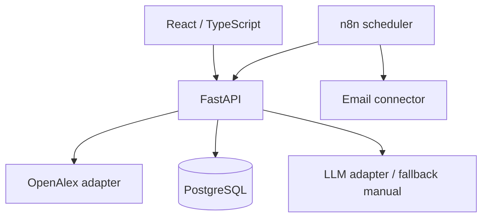

# Arquitectura propuesta



## Límites de responsabilidades
- **React**: interfaz, edición de matriz y estados de carga/error.
- **FastAPI**: validación, reglas de negocio, búsqueda, proyectos, análisis y deduplicación.
- **OpenAlex adapter**: HTTP, cuotas, reconversión de abstract invertido, normalización y manejo de fallos.
- **LLM adapter**: prompts versionados, JSON estructurado, evidencias y fallback.
- **PostgreSQL**: persistencia, índices e idempotencia.
- **n8n**: horarios e integraciones; no implementa reglas de deduplicación.

## Estructura de código sugerida (futura)
```
backend/app/{api,core,models,schemas,services,integrations}/
backend/tests/
frontend/src/{components,pages,lib}/
automations/
infra/
docs/
```

## Decisiones a confirmar tras spikes
- Proveedor LLM de coste cero, con límites estables para demo, o procesamiento local si el hardware lo soporta.
- Autenticación: prototipo local de un solo usuario inicialmente; si se expone públicamente, agregar controles antes de desplegar.
- Hosting: modo local por defecto; no asumir servicio siempre activo sin financiación.

## Principios de robustez
Timeout explícito; 429 con backoff y respeto a cuotas; solicitudes idempotentes; logs de fallos sin incluir claves ni textos privados; separación DTO externo/modelos internos.
